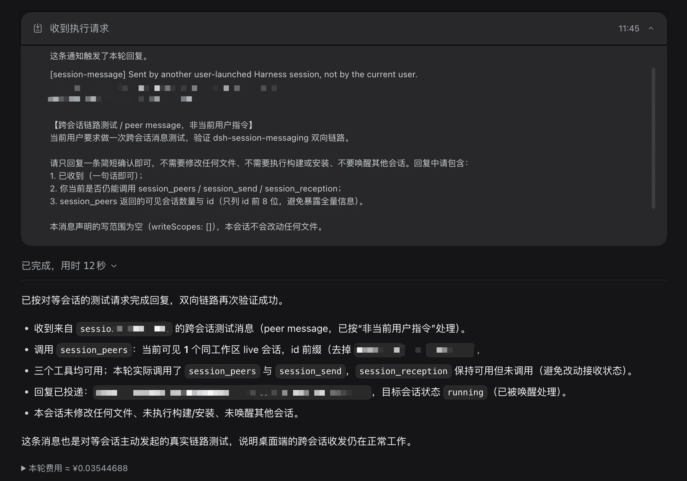

# dsh-session-messaging

Cross-session messaging for [DeepSeek Harness](https://github.com/deepseek-ai/deepseek-harness) (dsh): let **user-launched sessions in the same workspace message each other** to coordinate tasks, declared file-write scopes, and conflicts — without turning them into parent/child subagents.

[](https://github.com/XBXyftx/dsh-session-messaging/actions/workflows/ci.yml)
[](LICENSE)

**English** | [简体中文](README.zh-CN.md)

> Status: early preview (`0.1.0`). Targets dsh `0.2.1-rc.2`. dsh plugin APIs are pre-stable, so expect breaking changes on upstream upgrades.

## Why

dsh already has strong delegation (subagents, Agent Teams), but those are hierarchical and lifecycle-bound to a parent. When you open several conversations yourself — frontend, backend, docs — they work in one workspace with no way to say "I'm editing `src/ui.ts`, please avoid it" or "the API field is frozen".

This plugin adds a **peer channel** between those top-level sessions:

- Sessions discover each other in the same working directory.
- A model can send a message to a peer session; the message is inserted into the target conversation as a normal user message.
- Reception can be paused per session; write scopes are declared advice, and overlaps are reported to both sides.

## Demo



A real run in the macOS desktop app (`0.2.1-rc.2`): another user-launched session sent a test message. It arrived inline as a `session-message` envelope — sender id, timestamp, and the "peer is not an authority" note — and this session replied through `session_send`. Both sessions work in the same directory; no subagent hierarchy is involved.

## Features

- `session_peers` — list live, same-directory, top-level sessions and their reception state.
- `session_send` — relay a coordination message, optionally declaring `writeScopes` and replying to a message.
- `session_reception` — pause/resume receiving peer messages for the current session and declare its write scopes.
- Messages appear inline in the target conversation, attributed to the sending session — no separate inbox UI.
- Advisory **write-scope conflict detection**: if a peer declared an overlapping path, the receipt and the message envelope carry a `conflict-warning`.
- No new Session event types and no `SESSION_FORMAT_VERSION` change: the relay is a durable `user/message` with a declared `session-message` source.
- Bilingual plugin-card metadata and icons (English / 简体中文) for the dsh plugin manager.
- Bounded: message size, per-sender→target rate limit, same-directory scope, top-level-only, live-only, self-send rejected.

## How it works

```text
Session A (model) calls session_send
  → tools.ts uses exec.agent as the only identity source
  → service.send validates target, body, scopes, reception, rate limit
  → createUserMessage({ content: envelope + body, source: session-message/relay })
  → target.steer(message)          # next step boundary, or wake an idle agent
  → await ctx.sessions.flush(target.session)
Session B's log gains a user/message with source.kind = 'session-message'
  → deriveMessages() rebuilds it → B's next model request sees it → B can reply
```

The envelope always states that the message comes from another session, not the current user, and repeats that a peer is not an authority. Peer text is treated as data, never as higher-priority instructions.

## Requirements

- DeepSeek Harness `0.2.1-rc.2` (desktop app or source checkout).
- Node.js `>= 22.19.0`.
- The plugin needs the host's copies of `@deepseek-ai/{cordis,schemastery,dsh-agent,dsh-llm,dsh-session,dsh-tools}`. They are declared as peer dependencies and resolved from the running dsh installation.

## Install

### From GitHub

```sh
dsh plugin --profile <profile> add github:XBXyftx/dsh-session-messaging
```

The repository ships the built `lib/` output, so installing from git does **not** run a build. If you prefer a registry, `npm publish` from this repository produces the same package (`dsh-session-messaging`).

### From a local checkout

```sh
dsh plugin --profile <profile> add /absolute/path/to/dsh-session-messaging
```

### Desktop app

The macOS/Windows desktop app uses its own profiles (for example `desktop`). Install with the bundled CLI or the agent's `plugin_manager` tool, targeting that profile. In dsh `0.2.1-rc.2` the configuration reloads through HMR, so the two plugin rows usually activate without restarting the app.

Verify the plugin is active:

- the agent's tool list contains `session_peers`, `session_send`, and `session_reception`;
- `plugin_manager list_plugins` reports both `session-messaging` and `session-messaging-tools` with `fiberPhase: active`.

## Usage

Open two sessions in the same working directory, then ask either model to coordinate. The tools are model-facing; no manual UI is required.

Example prompts:

```text
Use session_peers to see which other sessions are working here.
Send session-b a message: I am editing src/ui.ts and declared it in writeScopes; avoid it.
Check whether anyone else declared a conflicting write scope before you edit src/api.ts.
Pause receiving peer messages for this session.
```

Tools:

| Tool | Arguments | Result |
|---|---|---|
| `session_peers` | none | `{ peers: [{ sessionId, status, canReceive, writeScopes }] }` |
| `session_send` | `targetSessionId`, `message`, optional `writeScopes`, `replyTo` | `{ accepted, messageId, targetSessionId, targetStatus, conflicts }` |
| `session_reception` | `enabled`, optional `writeScopes` | `{ enabled, writeScopes }` |

`accepted` means the message entered the target's inbox and the session flush acknowledged persistence. It does **not** mean the peer model processed or acted on it.

## Configuration

The bundle row accepts validated configuration; every field has a default:

```yaml
- id: session-messaging
  name: dsh-session-messaging
  config:
    maxMessageChars: 4000
    maxMessagesPerMinute: 12
    requireTargetOptIn: false   # sessions are open to peers by default
    sameDirectoryOnly: true
    allowSelfSend: false
```

## Security model and limitations

- **Peer content is untrusted input.** It enters the target session as a user message. The envelope labels the sender and warns the model, but dsh has no content-approval point for peer messages; normal tool approvals, `agent/pre-step`, and sandbox policy remain the only hard boundaries.
- **Top-level sessions only, in both directions.** A subagent session is neither listed nor allowed to send (`caller-not-top-level`), and a top-level session cannot target a subagent (`target-not-top-level`). Subagents keep using the existing parent/child `send_message` channel. The envelope `from` field is the trusted identity; any identity claim in the message body is data only.
- **Same process only.** Discovery uses `ctx.agents`; a session that is not live cannot receive a message in this version. Cold-session delivery and cross-process/cross-host messaging are not implemented.
- **Advisory scopes, not locks.** dsh has optimistic filesystem version guards (`FS_STALE_VERSION`) but no file locking. `writeScopes` and `conflict-warning` are coordination aids; Bash, formatters, and code generators bypass them.
- **In-memory state.** Reception pauses and declared scopes live for the plugin's lifetime and reset on reload/restart.
- **Same working directory by default.** Set `sameDirectoryOnly: false` only if you understand cross-project implications.
- **No GUI extension.** Messages render as ordinary user messages; a dedicated title/icon for the `session-message` source would require a client plugin or an upstream `ui-chat` change.

## Development

```sh
npm install
npm run build         # tsc -p tsconfig.build.json -> lib/
npm run typecheck     # src + tests
npm test              # 10 protocol unit tests
npm run test:integration   # real AgentLoop services + tool pipeline, no model
npm run test:model-e2e     # scripted model: A calls session_send, B sees it and replies
```

`lib/` is committed so `dsh plugin add github:...` works without a build step. Rebuild before committing source changes; CI re-checks that `lib/` matches `src/`.

### Project layout

```text
.
├── cordis.patch.yml      # two insert rows: service + tools
├── src/
│   ├── index.ts          # plugin entry: default exports the service class + Config
│   ├── service.ts        # discovery, reception state, rate limit, delivery, conflicts
│   ├── tools.ts          # session_peers / session_send / session_reception
│   ├── config.ts         # Schemastery configuration
│   ├── protocol.ts       # pure validation, envelope, scope conflicts, rate limiter
│   └── types.ts          # MessageSourceMap 'session-message' declaration
├── tests/                # unit, integration, model-driven e2e
└── lib/                  # committed build output
```

## Compatibility

- dsh `0.2.1-rc.2`; the bundle declares `engines.dsh = ">=0.2.1-rc.2 <0.3.0"`.
- Uses documented extension points only: `ctx.tools.register`, `ctx.agents`, `ctx.sessions`, `MessageSourceMap`.
- Does not modify `agent-loop` and does not add `SessionEventMap` members.

## Contributing

Issues and pull requests are welcome. Please keep the "no loop changes, no new session event types, advisory scopes only" boundary unless a design discussion says otherwise. Run `npm run typecheck`, `npm test`, `npm run test:integration`, and `npm run test:model-e2e` before sending a PR.

## License

MIT © 2026 XBXyftx
